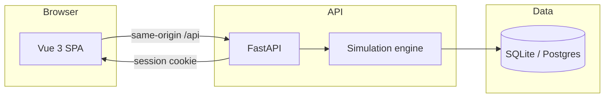

# NetPulse - Network Traffic & DNS Policy Console

[](https://netpulse-weld.vercel.app)
[](https://opensource.org/licenses/MIT)
[](https://www.python.org/)
[](https://vuejs.org/)
[](https://fastapi.tiangolo.com/)
[](https://www.postgresql.org/)
[](https://www.docker.com/)

[Deutsch](#deutsch) | [English](#english)

---

## Deutsch

### Übersicht

NetPulse ist eine simulierte ISP-Netzwerkbetriebskonsole. Sie erzeugt deterministischen
Verkehr aus einem Seed und leitet ihn durch konfigurierbare DNS-/Policy-Regeln, einen Cache
und ein Dashboard. Portfolio-Demonstration. Keine echten Pakete, keine echte Firewall, kein
echter DNS-Server.

**Live-Deployment:** [netpulse-weld.vercel.app](https://netpulse-weld.vercel.app)

### Funktionen

- Deterministische Simulation: Seed, Dauer, Anfragerate, Cache TTL/Kapazität/Policy
- Policy-Regeln: allow, block, rate-limit, route; prioritätsgeordnetes Matching mit
  Client-/Domain-Matchern (Wildcard, Gruppe, Kategorie)
- Workspace-bezogene Daten: anonyme Browser-Sitzungs-Workspaces per HttpOnly-Cookie
- Cache-Lab: LRU/FIFO/none Policies mit TTL-Ablauf und Eviction-Zählern
- Dashboard: Hit-Rate, blockierte Anfragen, durchschnittliche Latenz, Aktionsaufschluesselung
- Ereignis-Browser: Filterung nach Aktion/Client/Domain mit Seitennummerierung
- Berichte: JSON-Bericht mit Assertions und Limitationen

### Tech-Stack

Backend:
- FastAPI (Python 3.11+)
- SQLAlchemy ORM (SQLite Standard / PostgreSQL unterstützt)
- Alembic Migrations
- Pydantic Validierung

Frontend:
- Vue 3 (Composition API)
- Vite + TypeScript
- i18n (DE/EN)

Infrastruktur:
- Docker & Docker Compose
- Nginx (SPA-Server)

### Schnellstart

Voraussetzungen: Python 3.11+, Node 20+. Optional: PostgreSQL.

Backend:
```bash
cd backend
pip install -r requirements.txt
uvicorn app.main:app --reload --port 8000
```
Standardmäßig SQLite (`DATABASE_URL=sqlite:///./netpulse.db`).

Frontend:
```bash
cd frontend
npm install
npm run dev
```
Öffnen: http://localhost:5173

Docker (gesamter Stack):
```bash
docker compose up --build
```

### Konfiguration

| Variable | Standard | Hinweise |
|---|---|---|
| `DATABASE_URL` | `sqlite:///./netpulse.db` | Postgres unterstützt |
| `AUTO_CREATE_TABLES` | `true` | In Deployments auf `false` setzen |
| `COOKIE_SECURE` | `false` | Hinter HTTPS auf `true` setzen |
| `CORS_ORIGINS` | `http://localhost:5173` | Komma-getrennt |

### API

- `GET /api/health`
- `GET /api/clients`, `GET /api/domains` (gemeinsame Referenzdaten)
- `GET/POST/PUT/DELETE/PATCH /api/rules` (workspace-bezogen)
- `POST /api/simulate` (workspace-bezogener Lauf)
- `GET /api/runs`, `/api/runs/{id}`, `/api/runs/{id}/events`, `/api/runs/{id}/report`
- `GET /api/dashboard?run_id=`

### Tests

```bash
cd backend && pytest          # 14 Tests, SQLite
cd frontend && npm run build  # Type-Check + Build
cd frontend && npx playwright test
```

---

## English

### Overview

NetPulse is a simulated ISP-style network operations console. It generates deterministic
traffic from a seed and runs it through configurable DNS/policy rules, a cache, and a
dashboard. Built for portfolio demonstration. No real packets, no real firewall, no real
DNS server.

**Live Deployment:** [netpulse-weld.vercel.app](https://netpulse-weld.vercel.app)



### Features

- Deterministic simulation: seed, duration, request rate, cache TTL/capacity/policy
- Policy rules: allow, block, rate-limit, route; priority-ordered matching with
  client/domain matchers (wildcard, group, category)
- Workspace-scoped data: anonymous per-browser session workspaces via HttpOnly cookie
- Cache lab: LRU/FIFO/none policies with TTL expiry and eviction counts
- Dashboard: hit ratio, blocked count, avg latency, action breakdown
- Event browser: filter by action/client/domain with pagination
- Reports: JSON report with assertions and limitations

### Tech Stack

Backend:
- FastAPI (Python 3.11+)
- SQLAlchemy ORM (SQLite default / PostgreSQL supported)
- Alembic migrations
- Pydantic validation

Frontend:
- Vue 3 (Composition API)
- Vite + TypeScript
- i18n (DE/EN)

Infrastructure:
- Docker & Docker Compose
- Nginx (SPA server)

### Quick Start

Prerequisites: Python 3.11+, Node 20+. Optional: PostgreSQL.

Backend:
```bash
cd backend
pip install -r requirements.txt
uvicorn app.main:app --reload --port 8000
```
SQLite is used by default (`DATABASE_URL=sqlite:///./netpulse.db`).

Frontend:
```bash
cd frontend
npm install
npm run dev
```
Open http://localhost:5173

Docker (whole stack):
```bash
docker compose up --build
```

### Configuration

| Variable | Default | Notes |
|---|---|---|
| `DATABASE_URL` | `sqlite:///./netpulse.db` | Postgres supported |
| `AUTO_CREATE_TABLES` | `true` | Set `false` in deployed runs |
| `COOKIE_SECURE` | `false` | Set `true` behind HTTPS |
| `CORS_ORIGINS` | `http://localhost:5173` | Comma-separated |

### API

- `GET /api/health`
- `GET /api/clients`, `GET /api/domains` (shared reference data)
- `GET/POST/PUT/DELETE/PATCH /api/rules` (workspace-scoped)
- `POST /api/simulate` (workspace-scoped run)
- `GET /api/runs`, `/api/runs/{id}`, `/api/runs/{id}/events`, `/api/runs/{id}/report`
- `GET /api/dashboard?run_id=`

### Tests

```bash
cd backend && pytest          # 14 tests, SQLite
cd frontend && npm run build  # type-check + build
cd frontend && npx playwright test
```

---
